  

  
  
  
  

  

  

  

  
    Live:
    <a href="https://championseduhub.in">championseduhub.in</a> ·
    <a href="https://shaadavids.com">shaadavids.com</a> ·
    <a href="https://conceptsdesignstudio.in">conceptsdesignstudio.in</a> ·
    <a href="https://raintechsoftware.com">raintechsoftware.com</a> ·
    <a href="https://cryoflametechnologies.com">cryoflametechnologies.com</a> ·
    <a href="https://sdcarchitects.in">sdcarchitects.in</a>
  

  

  

  

  

  
  

  

  

